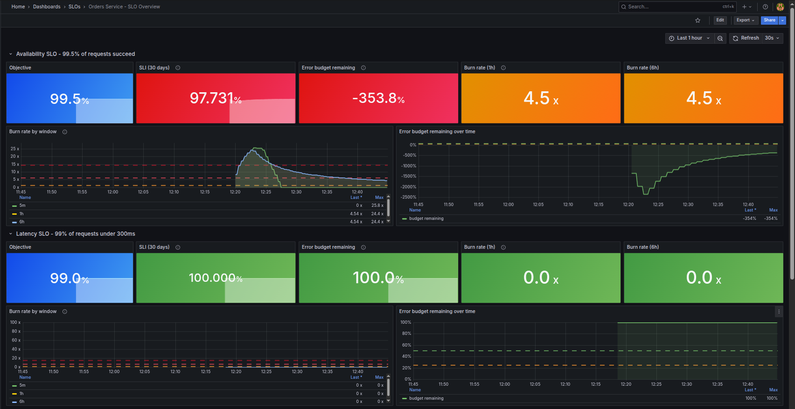
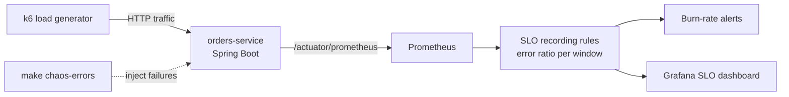

# Spring Boot SLO Monitoring - Error Budgets & Burn-Rate Alerts


**Stop alerting on every CPU spike. Alert when users are actually affected.**

A Spring Boot 4 service monitored the way Google SRE teams do it: defined **SLOs**, a tracked **error budget**, and **multi-window burn-rate alerts** that page only when the budget is genuinely at risk. A built-in chaos switch lets you break the service on purpose and watch the alerts respond.



## What's inside

| Part | Details |
|---|---|
| **orders-service** | Spring Boot 4 / Java 21 REST API, instrumented with Micrometer + Actuator (latency histograms, health probes, business metric) |
| **SLOs** | Availability 99.5% and latency 99% < 300ms over 30 days ([SLO document](docs/SLO.md)) |
| **Recording rules** | Error ratios for 8 windows (5m → 30d), error budget remaining, burn rates |
| **Alerts** | 4-tier multi-window burn-rate alerts per SLO, each with a [runbook](runbooks/) |
| **Dashboard** | SLO Overview: budget, burn rate, RED metrics, per-endpoint latency, JVM |
| **Traffic** | k6 generates steady load so the SLIs always have data |
| **Chaos** | `POST /chaos` injects errors or latency at runtime |
| **Quality** | Spring Boot integration tests, `promtool` unit tests for SLO rules, Trivy image scan, all in CI |

## How it works



**Why burn rate?** An error budget of 0.5% means the service can fail 1 in 200 requests per month. The burn rate measures how fast that budget is being spent: at **1x** it lasts exactly 30 days; at **14.4x** it would be gone in about 2 days, so on-call gets paged. Requiring both a long and a short window to be over the threshold means alerts fire fast for real incidents, stay quiet for brief blips, and clear quickly once the problem is fixed.

## Quick start

Requirements: Docker with Compose v2.

```bash
git clone https://github.com/ragulmk/spring-boot-slo.git
cd spring-boot-slo
make up
```

- API: http://localhost:8080/api/orders
- Grafana: http://localhost:3000 (`admin` / `admin`, or the values in `.env`)
- Prometheus alerts: http://localhost:9090/alerts

Give it a few minutes of traffic, then open the **Orders Service - SLO Overview** dashboard.

## Demo: break it and watch the SLO react

```bash
make chaos-errors    # 20% of requests now fail with 503
```

The 5-minute burn rate jumps to about 40x right away and the error budget starts to drop. **SLOAvailabilityBurnRateFast** fires once the 1-hour window also crosses 14.4x, which takes about 20-25 minutes at a 20% error rate. For a quicker demo, use `./scripts/chaos.sh errors 0.5` (fires in about 10 minutes). Watch it go from *pending* to *firing* at http://localhost:9090/alerts.

```bash
make chaos-off       # recover; the 5m window drops and the alert clears within minutes
make chaos-latency   # add 400ms per request and watch the latency SLO instead
```

## API

| Method | Path | Description |
|---|---|---|
| GET | `/api/orders` | List orders |
| GET | `/api/orders/{id}` | Get one order (404 if missing) |
| POST | `/api/orders` | Create `{"item": "keyboard", "quantity": 2}` |
| GET/POST/DELETE | `/chaos` | View / set (`?errorRate=0.2&latencyMs=300`) / reset fault injection |
| GET | `/actuator/health/{liveness,readiness}` | Kubernetes-style probes |
| GET | `/actuator/prometheus` | Metrics |

## Tests

```bash
make test         # everything (runs in Docker, no local Java or Prometheus needed)
make test-app     # Spring Boot integration tests
make test-rules   # promtool: SLO recording rules + alert unit tests
```

The rule tests prove the alerts behave correctly: a 10% error rate fires the fast page, a 0.2% error rate stays quiet, errors on `/actuator` don't count against the SLO, and a 5% slow-request rate raises a latency ticket.

## Using this for a real service

1. Replace `orders-service` with your app. Any Spring Boot 3/4 app with Actuator and `micrometer-registry-prometheus` exposes the same `http_server_requests_seconds` metrics.
2. Keep the `slo` histogram bucket in `application.yml` at your latency threshold.
3. Pick objectives with the product owner, then update `docs/SLO.md` and the rule thresholds.
4. Route alerts to Slack by connecting Prometheus to the Alertmanager from my [observability-stack](https://github.com/ragulmk/observability-stack) project.
5. Remove the `/chaos` endpoint, or protect it, before production.

## Project structure

```
├── app/               Spring Boot service, tests, multi-stage Dockerfile
├── prometheus/        scrape config, rules/ (SLO recording + alerts), tests/
├── grafana/           provisioned datasource and SLO dashboard
├── loadtest/          k6 traffic script
├── docs/SLO.md        SLO definitions and error budget policy
├── runbooks/          what to do when each alert fires
└── scripts/chaos.sh   fault injection helper
```

---

**Want SLOs and meaningful alerting for your own services?** I set this up for teams as a fixed-price engagement. Contact me on [LinkedIn](https://www.linkedin.com/in/ragulmanikandan/).

License: MIT
